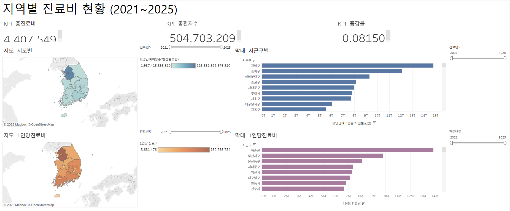
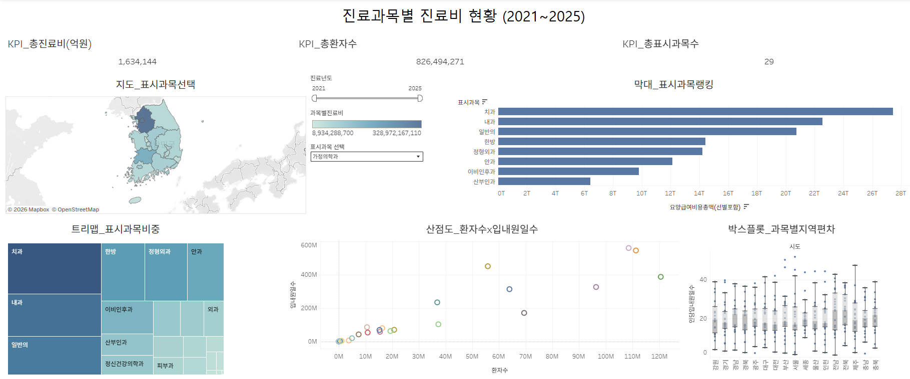
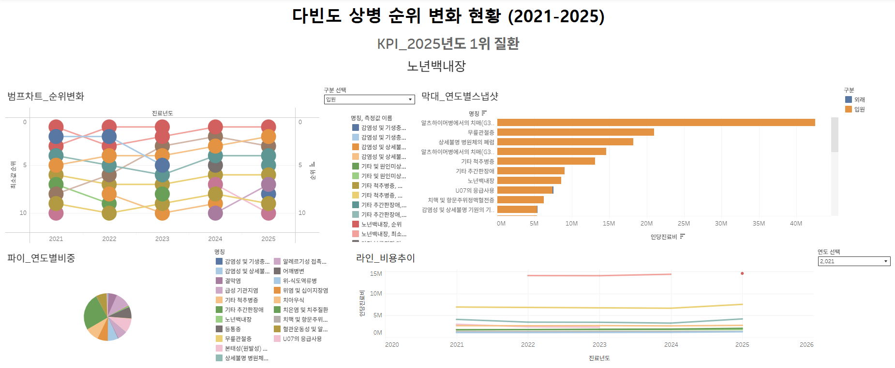

# HIRA 지역·질병별 진료비 대시보드

건강보험심사평가원(HIRA) 보건의료빅데이터개방시스템의 공개 통계를 활용해, 지역별·진료과목별·다빈도상병별 진료비 현황을 Tableau Public 대시보드 3종으로 시각화한 개인 포트폴리오 프로젝트입니다.

## 프로젝트 개요

- **데이터 출처**: 공공데이터포털(data.go.kr) / 건강보험심사평가원(HIRA)
  - 의료기관 시군구별 진료비 통계 (2021~2025)
  - 의원급 표시과목별 시도별 진료비 통계 (2021~2025)
  - 건강보험진료통계 - 다빈도상병별현황 (2021~2025)
- **전처리**: Google Colab (Python / pandas)
- **시각화**: Tableau Public
- **기간**: 2021년 ~ 2025년, 5개년

## 전처리 과정 요약

전체 코드는 [`notebooks/preprocessing.ipynb`](notebooks/preprocessing.ipynb)에 있습니다.

1. **인코딩 처리**: 공공데이터포털 CSV는 CP949(EUC-KR)로 인코딩되어 있고, 일부 파일은 `.zip` 확장자이지만 실제로는 일반 텍스트 파일이라 `compression=None`으로 읽어야 함
2. **5개년 데이터 병합**: 연도별로 흩어진 CSV/XLSX 파일을 한글 파일명 유니코드 정규화(NFC)를 거쳐 탐색한 뒤 `concat`으로 통합
3. **행정구역 변경 보정**:
   - 2023년 군위군(경북 → 대구) 편입 — 연도에 따라 "군위군"/"대구군위군" 두 표기가 섞여 있어 하나로 통일 후 재집계
   - 2024년 부천시의 소사구·원미구·오정구 분구 — 3개 구를 합산해 "부천시" 하나로 재통합
   - 보정 전후로 연도별 행정구역 집합을 비교하는 검증 로직을 추가해 누락·중복 없음을 확인
4. **컬럼명 불일치 해결**: 표시과목별 데이터의 2021년 파일만 컬럼명과 포맷이 달라(쉼표 포함 문자열, "선별포함" 표기 없음) 다른 연도와 분리되어 들어오던 문제를 발견 → 숫자 변환 + `combine_first`로 병합
5. **데이터 검증**: 결측치/중복행 점검, 음수값 점검, 환자수 0인데 비용이 있는 행 점검, 보험자부담금이 총진료비를 초과하는 이상행 점검
6. **최종 산출**: `data_cleaned/` 폴더의 CSV 3종

## 대시보드

### 1. 지역별 진료비 현황 (2021~2025)



**[Tableau Public에서 보기](https://public.tableau.com/app/profile/yunsu.park1982/viz/__17880950750250/sheet8?publish=yes)**

- 시도별 지도, 시군구별 진료비 랭킹, 1인당 진료비 기준 지도/랭킹, KPI(총진료비·총환자수·증감률)
- 총 진료비 기준으로는 서울 강남구 등 인구 밀집 지역이 상위를 차지하지만, **1인당 진료비 기준으로 보면 화순군·부산 서구 등 다른 지역이 상위권**으로 바뀜 — 총량과 1인당 지표가 서로 다른 그림을 보여준다는 점이 핵심 인사이트
- 진료년도 필터로 특정 연도만 선택해 볼 수 있음

### 2. 진료과목별 진료비 현황 (2021~2025)



**[Tableau Public에서 보기](https://public.tableau.com/app/profile/ysysyso/viz/__17881891104720/2021-2025?publish=yes)**

- 파라미터로 과목을 선택하면 색이 바뀌는 인터랙티브 지도, 과목별 랭킹 막대, 트리맵(비중), 산점도(환자수 x 입내원일수), 박스플롯(과목별 지역 편차), KPI 3종
- 치과·내과·일반의가 전체 진료비 상위를 차지
- 박스플롯으로 보면 과목에 따라 지역별 진료 강도 편차가 크게 다름 — 전국이 고른 과목과 지역차가 큰 과목이 뚜렷이 구분됨

### 3. 다빈도 상병 순위 변화 현황 (2021-2025)



**[Tableau Public에서 보기](https://public.tableau.com/app/profile/ysysyso/viz/__17949093404380/1?publish=yes)**

- 범프차트(연도별 순위 변화), 연도별 스냅샷 막대, 비중 파이차트, 비용 추이 라인차트, KPI(올해 1위 질환)
- 입원 기준 "노년백내장"은 5개년 내내 꾸준히 상위권 유지
- 반면 "U07의 응급사용"(코로나19 특수 분류 코드)은 연도별로 순위가 크게 출렁이는 모습을 보여, 감염병 유행 시기에 따른 의료 이용 패턴 변화를 간접적으로 확인 가능

## 폴더 구조

```
hira-region-disease-cost/
├── README.md
├── notebooks/
│   └── preprocessing.ipynb      # Colab 전처리 코드
├── data_cleaned/                # 전처리 완료된 CSV 3종
│   ├── gu_cost.csv
│   ├── subject_cost.csv
│   └── disease_top10.csv
├── screenshots/                 # 대시보드 스크린샷
└── tableau/                     # Tableau 통합 문서 원본(.twbx)
```

## 사용 기술

- Python (pandas) — 데이터 전처리, 인코딩/행정구역/컬럼 불일치 처리, 검증 로직
- Google Colab — 전처리 환경
- Tableau Public — 대시보드 제작 및 게시 (지도, 트리맵, 히트맵, 박스플롯, 산점도, 범프차트 등)